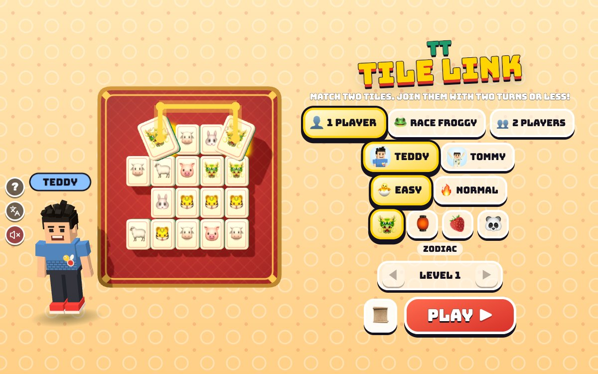

# TT Tile Link

[](https://adong.github.io/tile-link-tt/)

Press **?** any time (or tap the round **?** button on the left edge) to see the keys. The game waits while you look.
Tap the language button under it (the A文 icon) to switch between English and 中文; the dashboard and every game remember the choice.

**中文：** 连连看！找到两张一样的牌，用一条最多转两个弯的线连起来（线可以绕到牌外面）。十二生肖、中国（灯笼、红包、饺子、月饼……）、水果、动物四套牌，关卡越来越大；简单没有时间限制，普通有宽松的计时。一个人闯关，和 🐸 Froggy 或 🦊 Foxy 比赛，或者 Teddy 和 Tommy 两个人比谁先消完。还有一张中英文的小故事卡。

A tile-matching game (连连看, "link, link, look!") starring Teddy and Tommy, built with Claude Code from plain JavaScript and Three.js on the shared Claude Games kit. Part of the 中国 series: the tiles look like mahjong tiles, ivory on a jade-green back, laid on a red lacquer tray with a gold rim, and two of the four sets are the twelve zodiac animals and things from Chinese festivals and kitchens. There are no image, model or audio files: the boys are the kit's blocky characters, Froggy and Foxy are emoji on podiums, every tile is painted on a canvas, and every sound is synthesised.

The name lives in one constant, `TL_TITLE` in `js/title.js`; the page title, the logo and the ? panel read it from there.

## Play

- **Double-click `index.html`.** It works offline because Three.js and the kit are copied into `kit/`. Without internet the title font falls back to Arial Black.
- **Send one file:** `dist/tile-link-tt.html` is the whole game in one page. AirDrop or email it, then open it in a browser.
- Rebuild that file after any edit: `python3 kit/tools/bundle.py . --name tile-link-tt`

## How to play

- **Tap a tile, then its partner.** Two tiles with the same picture link when a line can join them **turning two times at most**, through empty spaces or **round the outside of the board** (the red tray has an empty ring all round for that). They pop off with a gold path, and the toast says the picture's name (🐴 HORSE! / 🐴 马！).
- **Two of the same that can't be joined** wobble and put themselves down: "TOO MANY TURNS!". Tapping a different picture just picks that one instead; tapping the same tile again puts it down.
- **🔀 Shuffle** (X) mixes the tiles left whenever you like, for free. **No link left?** The board says "NO PAIRS LEFT! SHUFFLE!" and mixes itself.
- **Every board can be cleared**, and so can every shuffle: a new board is dealt at random and checked by a solver; one that can't be cleared is dealt again (`js/rules.js`).
- **The winner** does his signature move beside the board (Teddy's boxing combo or his 🏀 jump shot, Tommy's Y with ✌️; Froggy and Foxy spin), with confetti, then **PLAY AGAIN** (or **NEXT LEVEL**).

### Modes

- **1 PLAYER:** levels that grow. 10 points a link, +5 for each link in a row (within 4 s, up to +25), and a 50-point bonus for a clear board. The HUD shows the level, the pairs left, your score and your best. Your best score and how far you've got are kept per player and level; the menu's ◀ LEVEL ▶ lets you start on any level you've reached.
- **RACE:** you and a friend get the very same board each; the first to clear his wins. 🐸 **Froggy** on EASY (a 4×4 board; he takes about a minute: 5.5–8 s a pair, a slip one time in four) and 🦊 **Foxy** on NORMAL (5×6; about 75 s: 3–4.6 s a pair, a slip one time in seven). A 3-2-1-GO! starts it, and GAMES WON keeps count.
- **2 PLAYERS:** Teddy and Tommy race on the same two boards (side by side on a wide screen, one above the other on a tall one), each tapping his own board, or W A S D + Space against the arrows + Enter.

### Levels

- **🐣 EASY** (the default, for Tommy, 5): no clock, big tiles, few pictures. Level 1 is 3×4 with 4 pictures; then 4×4, 4×5, 4×6, a 5×6 ring, 6×6, a 6×7 split down the middle and 6×8 with 10 pictures.
- **🔥 NORMAL** (for Teddy, 8): a relaxed clock (30 s plus 3.5 s a pair, and every link gives a second back); the seconds left are a bonus. TIME'S UP! only means TRY AGAIN. Level 1 is 5×6 with 9 pictures; then 6×8, a 6×9 split, a 7×10 ring, 8×10, an 8×12 diamond, an 8×12 ring and 8×12 with 20 pictures. Past the last level the biggest board comes round again in each shape.
- On a screen held upright the board turns on its side. A small screen gets fewer rows or columns rather than tiles too small to tap (40 px on EASY, 34 px on NORMAL), so a phone on its side plays EASY on 3 rows.

### The tiles and the story card

- **🐲 Zodiac:** the twelve animals in their real order (rat, ox, tiger, rabbit, dragon, snake, horse, goat, monkey, rooster, dog, pig).
- **🏮 China:** lantern, red envelope, dumplings, panda, chopsticks, tea, firecracker, mahjong, noodles, mooncake, kite, bubble tea, rice, fireworks, mandarin, peach, teapot, fish, full moon, dragon.
- **🍓 Fruit** and **🐼 Animals:** 20 pictures each.
- In 中文 the zodiac and China tiles carry their character small at the top, the way mahjong tiles do (鼠 牛 虎…, 灯笼, 饺子…). English mode shows no Chinese.
- **📜 The story** (B on the menu): four short pages, in English or 中文 — what Lianliankan means, mahjong at family holidays, the twelve zodiac animals (2026 is the Year of the Horse), and lanterns, red envelopes and mooncakes at the Lantern, Spring and Mid-Autumn Festivals.

## Controls

| | Keys | Touch |
|---|---|---|
| pick a tile, then its partner | ← ↑ → ↓ (or W A S D) then Enter or Space | tap them |
| shuffle the tiles | X | 🔀 (top right) |
| call your brother (2 players: high five) | T | his face, bottom right (🙌 in 2 players) |
| this level again | R | 🔄 in the pause menu |
| pause · sound | P or Esc · M | ⏸️ · 🔊 (top corners) |
| 2 players: Teddy · Tommy | W A S D + Space · ← ↑ → ↓ + Enter | each taps his own board |
| menu: play · the story | Enter · B | PLAY · 📜 |
| menu: 1 player · race · 2 players | 1 · 2 · 3 | the buttons |
| menu: Teddy or Tommy · level | W · L | the buttons |
| menu: the tiles · the starting level | ← → · ↑ ↓ | the buttons |

The arrows jump to the next tile that way. The mouse lifts the tile under it a little. The kit's ? and A文 buttons sit in the middle of the left edge (on a tall screen in a game, the bottom left corner; on a tall screen's title, the top left), beside the board, never on it.

## Companion

- **1 player and the race:** press **T** or tap your brother's face (bottom right) any time, as often as you like. The other brother (`Kit.roster.buddyFor`: Tommy for Teddy, Teddy for Tommy) pops in beside you at his `buddyScale` in a puff of stars ("TOMMY'S HERE!"), does his signature move (Tommy's Y with ✌️, Teddy's boxing or jump shot), and tosses you a treat (🍦 💧 🧃 🍪 🍉 🍌), which you then hold.
- **Then he shows you a pair:** he points, and **one matching pair glows blue-white with its path drawn between them**: "TOMMY SAYS: LINK THESE 🐴!". It's always a pair that keeps the board clearable (the solver's next link), and it glows until you link it or shuffle.
- He stays a few seconds to cheer your links, then does his goodbye move and pops out. Calling him again while he's there brings another hello, another treat and another pair.
- **2 players:** both brothers are already there, so T (or 🙌) is a **high five**: they run together, jump, slap hands (💥 🙌) and run back. It doesn't change the race.

## Checks

`node tools/check.js` (under a second; the page runs the same as `game.check()`):

- **paths:** the link rule on hand-made boards with known answers: side by side, straight across a gap, down a column, an L (one turn), a Z through the middle (two), a U round the left border, round the top border past a tile and over a wall, a pair that needs three turns (no link), one walled in (no link), crossed pairs (no link); a tile never links with itself or with a different picture.
- **versus:** the game's rule against a second, separate search (a breadth-first search over cells and directions that counts turns) on 300 random boards: 13,266 same-picture pairs, the same answer for every one, and every path the game draws is real (straight lines, only empty cells in between, at most two turns, the fewest turns).
- **boards:** 72 generated boards (every level of EASY and NORMAL, wide and tall, the zodiac's 12 pictures and more) hold exactly the tiles the level asked for and can be cleared: each clearing is replayed link by link with the second search.
- **reshuffle:** dead ends (crossed pairs, a 4×4 muddle) and muddled deals come back clearable with the same tiles on the same cells, and so does the shuffle button's mix; the sure builder (take linkable pairs off a full board) clears 3×4 to 8×12 in every shape.
- **games:** 40 bot games linking random pairs (which can walk into dead ends): every one ends with an empty board, reshuffling where it got stuck.
- **It can fail:** `node tools/check.js --can-fail` (or `game.checkCanFail()`) plants five bugs one at a time and every one is caught: `threeTurns` (a third turn allowed), `noBorder` (no going round the outside), `ghost` (lines pass through tiles), `noReshuffle` (a dead end stays dead), `oddDeal` (a tile with no partner). One at a time: `node tools/check.js --sabotage ghost`.

### Test hooks

```js
game.start({ mode: 'race', who: 'tommy', level: 'easy', theme: 'china', lv: 3, seed: 7 }) // mode solo | race | two
game.step(1)          // advance 1 s of game time (works while the tab is hidden)
game.hint()           // a good pair on the board: [cell, cell]; game.cells() is the board
game.tap(cell, 0)     // tap a tile on side 0's board (side 1: the other board in a race)
game.shuffle() · game.call() · game.timeUp() · game.story()
game.clearBoard(0)    // play side 0's board to the end with good links
game.info()           // state, level, score, sides (pairs, tiles left, board rectangle, tile size), the buddy, layout
game.check() · game.checkCanFail()
```

`node tools/shoot.js tools/shots.json docs 1200 750` takes `docs/screenshot.jpg` with headless Chrome (serve `~/claude-games` first; `URL=...` picks the address).

## Files

```
index.html       the page: the menu, the HUD, the panels, the story card, the icon
js/title.js      the name
js/rules.js      the link rule, the solver, dealing, reshuffles, the levels (no pictures: node runs it too)
js/check.js      the headless check and its sabotages
js/themes.js     the four sets of pictures, with their English and 中文 names
js/stage.js      the 3D table: the tray, the tiles, paths, deal, shuffle, glow, keyboard frame, screen <-> world
js/actor.js      the boys, Froggy and Foxy (from TT Memory Match)
js/buddy.js      your brother's visit and his pair, the 2-player high five (from TT Memory Match)
js/fx.js         flying emoji, word bursts, confetti (from TT Memory Match)
js/sfx.js        the sounds: tile clicks, the link chime up a pentatonic scale, the shuffle rattle, a gong for a win
js/game.js       the menu, the game, the race, the HUD, input, the loop, window.game
js/keys.js       the ? panel
js/zh.js         中文
tools/           check.js, shoot.js, shots.json
```

## Not verified

- Sound: every test ran muted; no sound was listened to.
- Real touch devices (iPad, phones, iOS Safari): layouts were checked at 1200×750, 1024×768, 768×1024, 390×844 and 740×360 in headless Chrome and the Browser pane, but no real finger played it.
- Whether the levels and the race friends suit the real Teddy and Tommy (Froggy's and Foxy's times come from test runs, not from the kids), and how NORMAL's 34 px tiles feel on a phone held sideways.
- Speed on an old iPad (an 8×12 board is 96 tiles with shadows), double-click from Finder (the pages were opened from file:// in headless Chrome only), the iPad home-screen icon.
- Emoji fonts: the tiles use emoji up to Emoji 13 (🫐 🧋 🫖), which need iOS 14 or newer.
